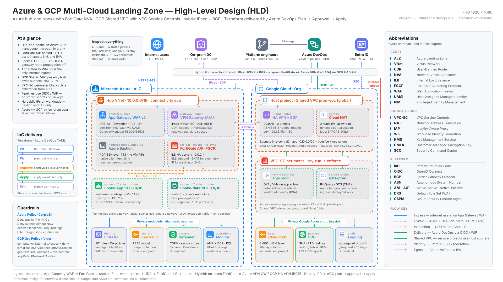

# Project-15 — Azure & GCP Multi-Cloud Interview Prep

Hands-on prep kit for a **Senior Cloud Engineer (Azure & GCP)** technical interview:
hybrid/multi-cloud networking, security, governance, and Terraform + Azure DevOps automation.



It contains three things:

1. **Question bank** (`docs/`) — 150+ interview Q&As with short, spoken-style answers.
2. **Reference code** (`terraform/`, `pipelines/`) — small, readable examples you can whiteboard from.
3. **Flashcard quiz** (`scripts/quiz.py`) — drills you on the question bank from the terminal.

---

## Repository layout

```
Project-15-Azure-GCP-Multi-Cloud-Interview-Prep/
├── docs/
│   ├── hld-azure-gcp-multicloud.svg      # HLD diagram (light/dark aware)
│   ├── 00-interview-game-plan.md          # 30-min flow, pitch, questions to ask
│   ├── 01-azure-hub-spoke-fortigate.md    # VNet, peering, UDR, FortiGate NVA HA, NSG, Bastion
│   ├── 02-azure-appgw-waf.md              # App Gateway v2, WAF, SSL, routing
│   ├── 03-azure-identity-governance.md    # Entra ID, RBAC, PIM, Policy, Key Vault, Defender
│   ├── 04-azure-operations.md             # Azure Monitor, Log Analytics, KQL, VMs
│   ├── 05-gcp-networking.md               # Shared VPC, Cloud Router, Cloud NAT, VPC-SC
│   ├── 06-gcp-iam-governance.md           # Hierarchy, IAM, Org Policy, WIF, KMS, SCC, Logging
│   ├── 07-terraform-azure-devops.md       # State, modules, Plan/Apply pipelines, Git flow
│   ├── 08-landing-zones-migration-cost.md # ALZ, GCP foundation, migration, FinOps
│   ├── 09-scenario-design-questions.md    # Whiteboard / troubleshooting scenarios
│   ├── 10-star-stories.md                 # Behavioural answers mapped from real experience
│   └── 99-cheat-sheet.md                  # One-page last-minute review
├── terraform/
│   ├── azure-hub-spoke/                   # Hub + spokes + UDR to FortiGate ILB + Bastion
│   └── gcp-shared-vpc/                    # Host/service projects, subnets, Router, NAT, org policy
├── pipelines/
│   └── azure-pipelines.yml                # Validate → Plan → Approval → Apply (OIDC / WIF)
└── scripts/
    ├── quiz.py                            # Flashcard drill from docs/*.md
    ├── gen_hld.py                         # Regenerates the HLD SVG
    └── assets/gcp-symbols.xml             # Google Cloud icons used by the HLD
```

---

## Run the flashcard quiz

**PowerShell**
```powershell
cd .\Project-15-Azure-GCP-Multi-Cloud-Interview-Prep
python .\scripts\quiz.py                       # all topics, shuffled
python .\scripts\quiz.py --topic gcp -n 15     # 15 GCP questions
python .\scripts\quiz.py --list                # show topics
```

**WSL Ubuntu**
```bash
cd ~/path/to/Project-15-Azure-GCP-Multi-Cloud-Interview-Prep
python3 scripts/quiz.py
python3 scripts/quiz.py --topic hub-spoke -n 10
python3 scripts/quiz.py --list
```

Press **Enter** to reveal the answer, `k` = knew it, `r` = review later, `q` = quit.
Missed questions are written to `review.md` (git-ignored).

---

## Validate the Terraform (no cloud credentials needed)

**PowerShell**
```powershell
foreach ($d in "terraform\azure-hub-spoke","terraform\gcp-shared-vpc") {
  terraform -chdir=$d init -backend=false; terraform -chdir=$d validate
}
```

**WSL Ubuntu**
```bash
for d in terraform/azure-hub-spoke terraform/gcp-shared-vpc; do
  terraform -chdir=$d init -backend=false && terraform -chdir=$d validate
done
```

> The code is intentionally compact for whiteboarding. It is not a production landing zone —
> for that, use Azure Verified Modules / ALZ and Google's Cloud Foundation Fabric.

---

## Regenerate the HLD

**PowerShell**
```powershell
python .\scripts\gen_hld.py
```

**WSL Ubuntu**
```bash
python3 scripts/gen_hld.py
```

## How to study (night before)

1. Talk through the HLD left-to-right in 3 minutes (ingress → inspection → hybrid → GCP perimeter → delivery).
2. Read `docs/00-interview-game-plan.md` and rehearse the 60-second pitch out loud.
3. Skim `docs/99-cheat-sheet.md`.
4. Run `quiz.py` on weak areas (`--topic gcp`, `--topic terraform`).
5. Walk through `terraform/azure-hub-spoke/main.tf` and explain each block in one sentence.
6. Rehearse 3 STAR stories from `docs/10-star-stories.md`.

## Author

**Ibn Abbas Mohammed Elhadi** — Senior DevOps / Cloud Engineer
Azure DevOps Engineer Expert · Azure Network Engineer Associate · Azure Administrator Associate ·
OCI Multicloud Architect Professional · Google Cloud Digital Leader
